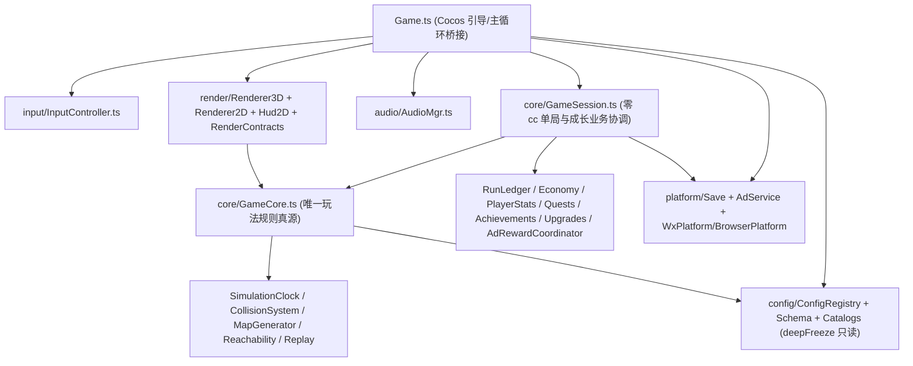
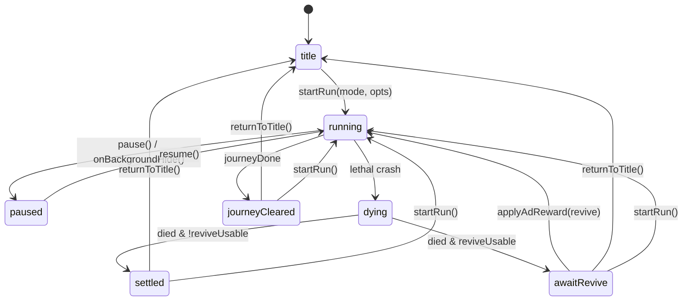

# Phase 8.2 — 核心架构重构与工程质量提升报告

> 执行日期：2026-11-26  
> 技术栈：Cocos Creator 3.8.8 / TypeScript / Vitest / 微信小游戏  
> 前置基线：Phase 8.1 (`264e2bc`)，246/246 单测通过、0 tsc/eslint 错误、微信构建 exit=36

---

## 一、前置验收与全量架构审计（Phase 8.2.1）

对 `Game.ts`、`GameCore.ts`、`MapGenerator.ts`、`Reachability.ts`、`Renderer3D.ts`、`Renderer2D.ts`、`Hud2D.ts`、`ProceduralKuafu.ts`、`CharacterAnimator.ts`、`RunLedger.ts`、`Economy.ts`、`PlayerStats.ts`、`Quests.ts`、`Save.ts`、`AdService.ts`、`AudioMgr.ts` 执行全量源码审计后，确认 Phase 8.1 全部核心修复均完整生效，同时发现并登记以下 8 项架构与资源问题：

| 编号 | 严重度 | 源码位置 | 问题描述与实际影响 | 处理方案 |
|------|--------|----------|--------------------|----------|
| A1 | 高 | `assets/scripts/Game.ts` | 引导层直接承载单局生命周期、任务/成就/皮肤/强化/广告发奖/备份恢复等全部业务编排，耦合 `cc.Component` 导致元进度集成流无法在纯 Node 下端到端测试 | 提取零 `cc` 依赖的 `core/GameSession.ts` 统一协调单局与成长业务，`Game.ts` 回归纯引擎桥接与输入/渲染装配 |
| A2 | 中高 | `assets/scripts/core/GameCore.ts` | 60Hz 固定步长时钟、连续扫描碰撞数学与主玩法循环混写在同一文件，难以单独对时钟/碰撞边界进行纯数学验证 | 务实提取 `core/SimulationClock.ts` 与 `core/CollisionSystem.ts`（零过度封装，保持 `GameCore` 对外 API 兼容） |
| A3 | 中 | `assets/scripts/core/GameCore.ts`、`core/types.ts` | 外部可直接读写核心可变字段；事件缺少统一 `runId`/`tick` 与 `runStart`/`revive`/`pause`/`resume`/`themeChange` 领域语义；无输入命令队列 | 新增 `CoreCommand` 命令队列、`ReadonlyCoreView` 只读视图、`CoreResourceStats` 统计快照及完整 `CoreEvent` 契约 |
| A4 | 中 | `assets/scripts/config/*` | 各 JSON 配置分别校验，缺少跨文件引用一致性校验（皮肤售价、地块主题索引、视野跨度、征途递增），且运行期共享配置未冻结 | 新增 `config/ConfigRegistry.ts`（`validateAllConfigs` + `deepFreeze`），统一 `SkinCatalog.SKIN_COSTS` 与 `DEFAULT_SKIN_ID` |
| A5 | 高（真实缺陷） | `assets/scripts/render/ProceduralKuafu.ts:135` | `root.setPosition(root.position.x, this._lastHop, 0)` 每帧将 `root.position.z` 强制归零并覆盖 `Renderer3D.placeKuafu` 写入的斜坡/断桥高度 `r.y` | 在 `AnimInput` 增加 `groundY?: number`，基于 `groundY + this._lastHop` 更新 Y 并保留 `root.position.z` |
| A6 | 高（资源泄漏） | `assets/scripts/render/Renderer3D.ts:646-656` | `destroy()` 仅清空 `matCache` 未调用 `mat.destroy()`，且 `pools`/`decorPools`/`segNodePool`/`puffPool` 中已脱离场景树的节点从未销毁，多次场景重建会泄漏 Material 与 Node | 完整销毁 `matCache` 全部材质、`segViews` 装饰节点与全部对象池节点，并清空所有 Map/数组；新增 `getResourceStats()` |
| A7 | 中（资源泄漏） | `assets/scripts/audio/AudioMgr.ts:28,117-130` | 构造函数创建的 `sfxSource` 从未使用（音效全部走 `sfxPool`），且 `destroy()` 未重置 `loaded = false`，且 `setMuted(true)` 未停止池内音效 | 移除冗余 `sfxSource`，静音时停止全部 `sfxPool` 实例，`destroy()` 重置 `loaded = false` |
| A8 | 中（真实缺陷） | `assets/scripts/core/AdRewardCoordinator.ts:158-174` | `timedPower` 与 `skinTrial` 票据缺少单次消费锁，同一票据被重复投递时可能重复返回 `applied: true` | 为全部 `AdRewardTicket` 分配单调 `ticketId` 并维护 `consumedTickets` 集合，确保任意票据最多兑现一次 |

---

## 二、核心架构关系与状态机

### 2.1 分层与依赖方向

- **严格约束**：`core/*`、`config/*`（除 `GameConfig.ts` 加载器）与 `render/RenderContracts.ts` 保持**零 `cc` 依赖**，可直接在 Node/Vitest 下完整执行。
- **渲染只读边界**：渲染层仅读取 `GameCore` 只读状态/视图（`core.view`）与领域事件流（`drainEvents()`），不修改任何核心玩法状态。

### 2.2 单局会话生命周期状态机（`GameSession`）

---

## 三、商业级 3D 美术资产替换契约（Phase 8.2.9）

新增纯 TypeScript 契约文件 `assets/scripts/render/RenderContracts.ts`，并在 `Renderer3D` 构造函数预留可选注入点 `{ characterProvider?, sceneBinder? }`：

- **`CharacterAssetProvider<TNode>` / `CharacterVisualHandle<TNode>`**：支持未来无缝替换为 FBX/glTF 绑定骨骼模型，内置动画片段映射 `clipMap`（`idle/run/jump/slide/stumble/dead`）、LOD 切换 `setLod(0|1|2)`、配饰挂点表 `sockets`（`head/back/hand/aura`）与纯视觉皮肤描述符 `CharacterSkinVisual`。
- **`SceneAssetBinder<TNode>`**：支持障碍、道具、装饰与模块化地块资产从程序化几何体替换为 Prefab/glTF，未提供或返回 `null` 时自动回退默认程序化构建，**完全不触碰 `GameCore`、`GameSession`、`CollisionSystem` 或 `Reachability`**。
- **`RenderResourceStats` / `ResourceTracker`**：开发期实时统计活跃地块、障碍、碎片、道具、装饰、动态 Mesh、缓存 Material、对象池节点与粒子数，并支持销毁归零泄漏断言。

---

## 四、验证证据

| 检查项 | 命令 / 范围 | 实际结果 |
|--------|-------------|----------|
| 类型检查 | `npm run type-check` (`tsc --noEmit -p tsconfig.tests.json`) | **0 错误** |
| 代码规范 | `npm run lint` (`eslint "assets/scripts/**/*.ts" "tests/**/*.ts"`) | **0 错误，0 警告** |
| 自动化测试 | `npm test` (Vitest) | **18/18 文件通过，263/263 用例全绿**（含 Phase 8.2 新增 17 项架构/生命周期/碰撞/重放/配置冻结/资产替换/资源有界回归测试 + Phase 8.1 1000 种子零无敌真实核心重放 0 死亡） |
| 微信小游戏构建 | `./scripts/build-wechat.sh` (Cocos Creator 3.8.8 CLI) | **通过**（exit=36，耗时 4s，`Missing class = 0`，`main/index.js` 442KB，确认 `SimulationClock`/`CollisionSystem`/`GameSession`/`ConfigRegistry`/`RenderContracts` 全部入包） |

---

## 五、剩余风险与人工阻塞项

1. **真机性能与视觉验收（人工阻塞）**：当前无真机与微信开发者工具服务端口权限，真机 30/60 FPS、发热、触控手感、3D 相机尺度及微信主包分包体积仍需人工在微信开发者工具与 Android/iOS 真机上验证（不以 Node 逻辑层耗时替代真机帧率）。
2. **正式广告位 ID 与测试期开关**：`ad.enabled=false`、`ad.adUnitIds` 留空与默认静音为测试期配置，正式提审前需填入真实广告位并恢复默认配置。
3. **本阶段已停止**：按阶段纪律，Phase 8.2 完成后停止并等待独立审查验收，未进入正式 3D 美术生产。
